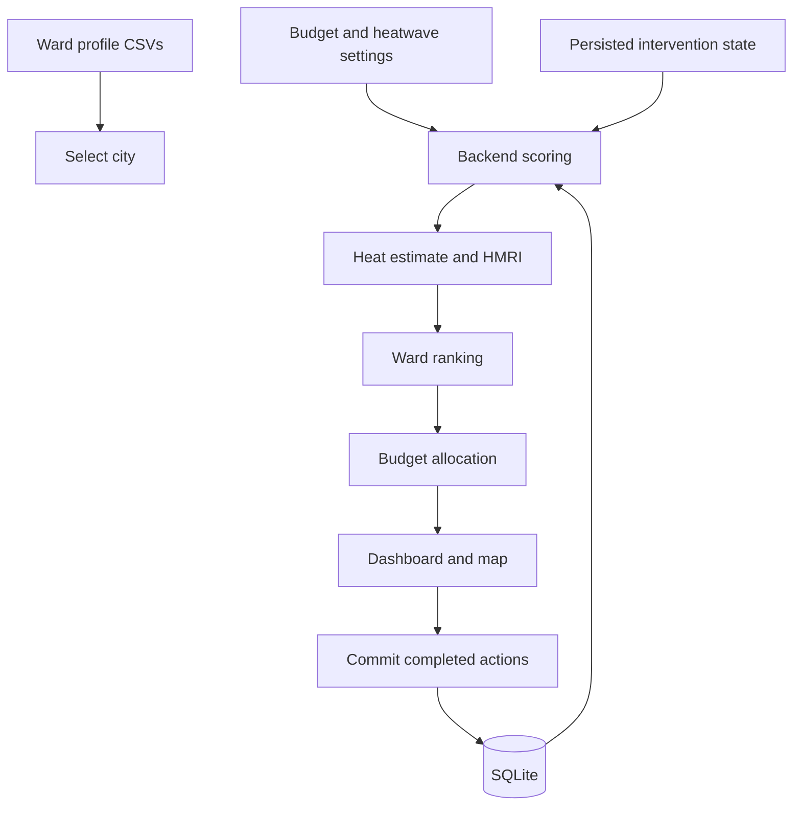
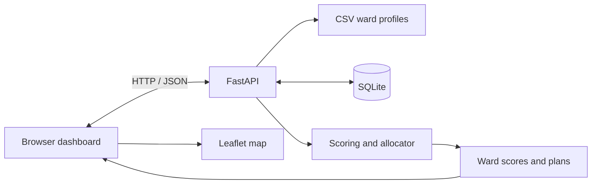

<div align="center">

# 🌡️ Heat-CDD | Cool Block Commander

### Ward-level urban heat-risk intelligence and climate-intervention planning for Mumbai & Mysuru

**Map heat vulnerability · Prioritize communities · Plan cooling interventions · Track implementation**

  

</div>

---

## Overview

**Cool Block Commander** is a prototype decision-support dashboard for exploring ward-level heat vulnerability and planning cooling interventions under a configurable budget. It includes ward profiles for **Mumbai (24 wards)** and **Mysuru (15 zones)**, a FastAPI backend, an interactive map, synthetic sample datasets, and SQLite-backed tracking of committed interventions.

> **Naming note:** Although the repository is named `heat-CDD`, the checked-in implementation does not define or use “CDD” as a specific climate metric. This README describes the WBGT-like and HMRI scoring workflow present in the code.

### What it does

- Visualizes ward/zone profiles on an interactive Leaflet map.
- Calculates a simplified WBGT-like heat estimate and Heat Mortality Risk Index (HMRI).
- Ranks wards by a composite priority score.
- Proposes interventions within a user-configured budget.
- Tracks actions marked as completed using SQLite.
- Provides city selection and officer registration/login screens.

### What it does not demonstrate

- A live weather-data ingestion pipeline.
- Reproducible model training or evaluation.
- A validated heat-health forecasting system.
- Production-ready authentication or deployment security.

The included training datasets are **synthetic**, generated with random sampling and formulas—not measured historical weather or health data.

---

## Cities & Data

| City | Areas | Ward profile | Geometry |
|---|---:|---|---|
| Mumbai | 24 wards | `backend/data/mumbai_24_wards_master.csv` | GeoJSON fetched externally by the frontend |
| Mysuru (Mysore) | 15 zones | `backend/data/mysore_wards_master.csv` | Geometry embedded in `frontend/index.html` |

The synthetic training CSVs contain 1,200 rows per city and these features/targets:

`forecast_temp_c`, `relative_humidity_pct`, `solar_radiation_mj`, `green_cover_pct`, `tin_roof_pct`, `elderly_children_pct`, `low_income_score`, `wbgt`, `hmri`.

The data generator is `backend/generate_db.py`. Its outputs are formula-generated synthetic data.

---

## Methodology

The current optimizer uses heuristic calculations in `backend/main.py`; it does not run an XGBoost model as part of optimization.

### WBGT-like estimate

The backend combines a city-specific base temperature, longitude-derived adjustment, user-selected heatwave surge, and a modeled cooling adjustment from previously tracked actions:

`WBGT estimate = base + inland adjustment + heatwave surge − modeled cooling`

This is a simplified estimate, not a standard WBGT calculation using measured meteorological inputs.

### Heat Mortality Risk Index (HMRI)

The code normalizes the heat hazard and applies vulnerability amplification using ward-profile indicators, including elderly/children share, low-income score, and green-cover deficit. The resulting HMRI is clipped to a bounded score. It is a prototype index and is not calibrated to observed illness or mortality.

### Priority score

Wards are ranked using a weighted combination of HMRI, estimated heat, and vulnerability indicators. The ranking is intended to support exploration and prioritization—not establish an authoritative risk classification.

### Planning workflow



---

## Intervention planning

The current budget allocator selects from four intervention types:

| Intervention | Default cost assumption | Simulated HMRI reduction |
|---|---:|---:|
| Cool roof (displayed as 500 m²) | ₹125,000 | 8 points |
| Water kiosk | ₹75,000 | 5 points |
| Transit shade shelter | ₹150,000 | 8 points |
| Miyawaki tree block (50) | ₹60,000 | 5 points |

These are prototype assumptions, not sourced cost estimates or measured effectiveness. Although the interface exposes additional intervention cost controls, the current allocation loop does not select all of those categories.

---

## Architecture

- **Frontend:** HTML and JavaScript; Tailwind CSS loaded from CDN; Leaflet maps.
- **Backend:** FastAPI in `backend/main.py`.
- **Data:** CSV ward profiles and synthetic training data.
- **Persistence:** SQLite for user and committed-action state.
- **Scoring/planning:** Python, NumPy and Pandas.



## Repository structure

```text
heat-CDD/
├── backend/
│   ├── main.py
│   ├── generate_db.py
│   └── data/
│       ├── mcgm_portal.db
│       ├── mumbai_24_wards_master.csv
│       ├── mysore_wards_master.csv
│       ├── mumbai_historical_training_db.csv
│       ├── mysore_historical_training_db.csv
│       ├── municipality_logins.csv
│       └── registered_officers.csv
├── frontend/
│   ├── index.html
│   ├── script.js
│   └── mysore-wards.geojson
└── requirements.txt
```

The main dashboard is served from `frontend/index.html`; much of its JavaScript is inline. `frontend/script.js` is a separate/older script and is not the main script used by the current HTML dashboard.

---

## Quick start

### Requirements

- Python 3.10+ recommended
- pip
- Internet connection for frontend CDN assets and external Mumbai geometry

### 1. Clone and enter the project

```bash
git clone https://github.com/r-samarth/heat-CDD.git
cd heat-CDD
```

### 2. Create a virtual environment

**Windows PowerShell**

```powershell
python -m venv .venv
.\.venv\Scripts\Activate.ps1
```

**macOS/Linux**

```bash
python3 -m venv .venv
source .venv/bin/activate
```

### 3. Install dependencies

```bash
pip install -r requirements.txt
```

### 4. Run the backend

```bash
cd backend
uvicorn main:app --reload
```

Open:

- Dashboard: http://127.0.0.1:8000/
- Swagger API docs: http://127.0.0.1:8000/docs
- OpenAPI schema: http://127.0.0.1:8000/openapi.json

The backend initializes its SQLite tables and ward-profile files on startup. Leave the server running while using the dashboard.

---

## API reference

| Method | Endpoint | Description |
|---|---|---|
| `GET` | `/` | Serves dashboard |
| `GET` | `/api/cities` | Supported city IDs and counts |
| `POST` | `/optimize` | Scores wards and returns budget recommendations |
| `POST` | `/api/register` | Registers officer |
| `POST` | `/api/login` | Checks login |
| `POST` | `/api/verify-budget-password` | Checks budget-control authorization |
| `POST` | `/api/commit-actions` | Persists committed actions / advances planning day |

### Example optimization request

```bash
curl -X POST http://127.0.0.1:8000/optimize \
  -H "Content-Type: application/json" \
  -d '{
    "city": "mumbai",
    "budget": 5000000,
    "heatwave_surge_c": 6.0
  }'
```

Supported city values are `mumbai` and `mysore`. Optional cost override fields include `cost_roof`, `cost_kiosk`, `cost_shade`, and `cost_trees`.

### List cities

```bash
curl http://127.0.0.1:8000/api/cities
```

The `/optimize` response includes metadata, summary budget/risk metrics, and ward-level scores, ranks, recommendations, and previously recorded intervention state. Consult `/docs` for the live request and response schemas.

---

## Regenerate synthetic data (optional)

Run from the backend directory:

```bash
cd backend
python generate_db.py
```

**Warning:** This script regenerates and overwrites the synthetic CSV files in `backend/data/`. Existing generated files can be used without running it.

## Reported metrics

The application currently displays these metric values:

| Target | R² | RMSE | MAE |
|---|---:|---:|---:|
| WBGT | 0.7685 | 1.1261 | 0.8509 |
| HMRI | 0.8920 | 2.1400 | 1.6200 |

They are embedded in backend output and cannot be independently reproduced from the repository's included training/evaluation workflow. No model artifact is included, and the optimization route uses heuristic calculations rather than that model. Treat these as UI-reported values, not verified performance results.

---

## Limitations & responsible use

- Training data are synthetic and formula-generated.
- WBGT-like estimates and HMRI are simplified, unvalidated heuristics.
- Ward indicators and intervention assumptions require provenance, calibration, and field validation.
- The code references a model artifact that is not included.
- Weather-source metadata does not mean live weather ingestion is implemented.
- Authentication is prototype-level. Do not use real credentials or sensitive municipal data without security hardening, secure password storage, secret management, validation, and access controls.
- External CDN and map/geometry services are dependencies.
- Simulated intervention reductions are not measured effectiveness.

**Do not use this prototype as the sole basis for public-health, emergency-response, or budget decisions.** Expert review, validated data, calibration, and safeguards are needed before operational deployment.

## Roadmap

- [ ] Add reliable documented weather ingestion and forecast data.
- [ ] Document ward data provenance and refresh process.
- [ ] Create reproducible training and validation pipeline.
- [ ] Validate scoring against authoritative observations and health evidence.
- [ ] Source intervention costs/effectiveness and add sensitivity analysis.
- [ ] Harden authentication and role-based permissions.
- [ ] Add tests, deployment configuration, and error handling.
- [ ] Add screenshots and scenario walkthroughs.

## Contributing

Issues, suggestions, and focused pull requests are welcome.

- [Issues](https://github.com/r-samarth/heat-CDD/issues)
- [Pull requests](https://github.com/r-samarth/heat-CDD/pulls)

## Acknowledgements

Built with [FastAPI](https://fastapi.tiangolo.com/), [Leaflet](https://leafletjs.com/), [OpenStreetMap](https://www.openstreetmap.org/), [Tailwind CSS](https://tailwindcss.com/), Pandas, NumPy and the broader urban-climate research community.

The repository does not include a formal bibliography or data-source citation list for its synthetic data and ward indicators.

## License

No license file was present when this README was prepared. Unless a license is added, reuse and redistribution are not explicitly granted under an open-source license.

---

<div align="center">

*Prototype for exploring urban heat resilience and equitable cooling-resource planning.*

</div>
